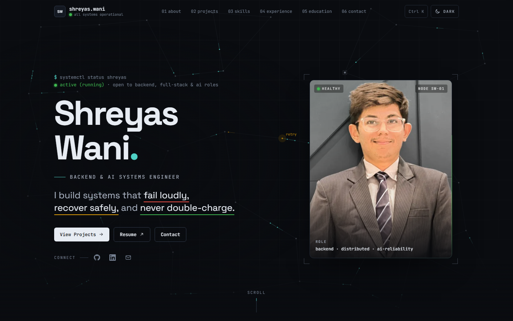

# Shreyas Wani — Portfolio

[](https://github.com/shreyas0917/Portfolio/actions/workflows/ci.yml)


**Live site: [shreyas-portfolio-eight.vercel.app](https://shreyas-portfolio-eight.vercel.app/)**

[](https://shreyas-portfolio-eight.vercel.app/)

A personal developer portfolio for a backend and AI systems engineer, designed as an
**observability console**: a charcoal/slate palette, status-light accents (green healthy ·
amber retry · red failure), a generative "live system" hero, and motion that respects
`prefers-reduced-motion`.

## Features

- Home sections: hero, about, projects, skills, experience, education, contact.
- A page for each project, with an interactive architecture diagram.
- Skills marked as used in projects, used to build this site, or hands-on practice.
- Command palette (`Ctrl K` / `⌘K`), light and dark themes, reduced-motion support.
- Lighthouse 96 mobile / 100 desktop, with SEO tags and share images built at build time.

## Tech stack

React 18 · TypeScript · Vite 5 · Tailwind CSS 3 · Framer Motion · GSAP · Lenis · GitHub Actions

## Run it

```bash
npm install
npm run dev        # http://localhost:5173
npm run build      # typecheck + production build → dist/
npm run preview    # serve dist/ at http://localhost:4173
```

Requires Node 18+ (built with Node 22). CI (`.github/workflows/ci.yml`) runs the typecheck
and build on every push and pull request to `main`.

## Edit the content

All content lives in `src/data/`: `profile.ts`, `projects.ts`, `skills.ts`,
`experience.ts`, `education.ts`. Edit there, not in the components.

- Missing facts are written as `[to fill]` and show as dashed placeholders.
- Skills linked to projects are worked out from the project text, so they stay in sync.

## Contact form

The form posts to [Formspree](https://formspree.io). Copy `.env.example` to `.env.local`
and set `VITE_FORMSPREE_ENDPOINT`. Without it, the form is disabled and shows the email.

## Deploy

1. Set `SITE_URL` in `src/data/site.ts` to the real address.
2. Add `VITE_FORMSPREE_ENDPOINT` to the host's environment variables.
3. Import the repo on Vercel (`vercel.json`) or Netlify (`netlify.toml`). The build
   command is `npm run build` and the output directory is `dist`.
